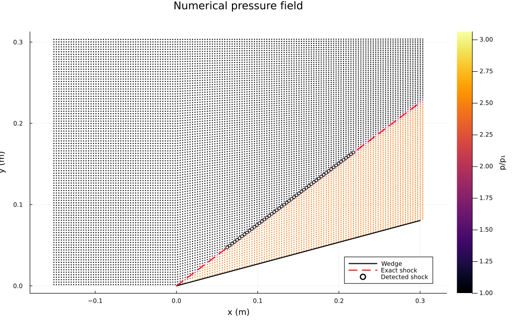
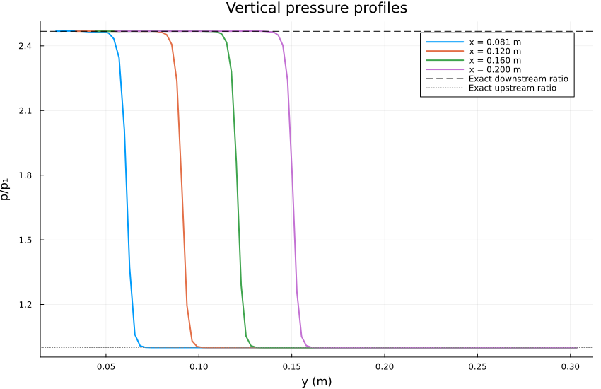
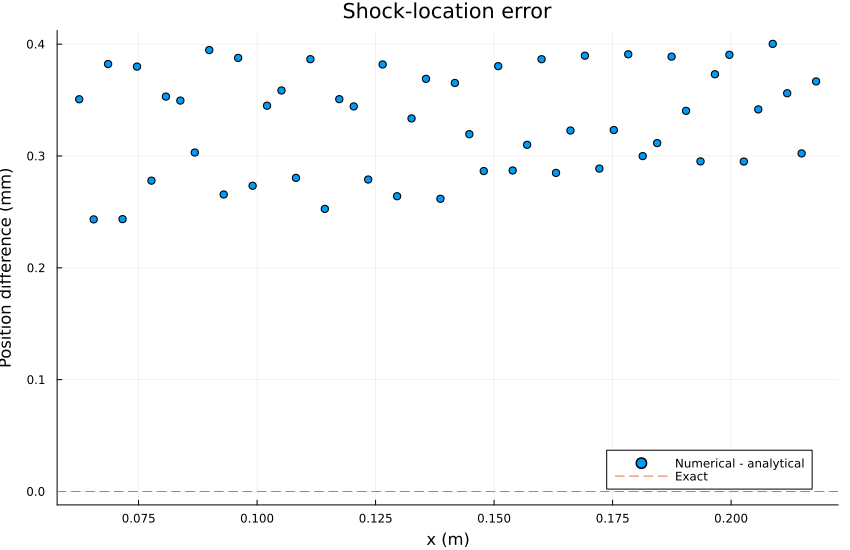
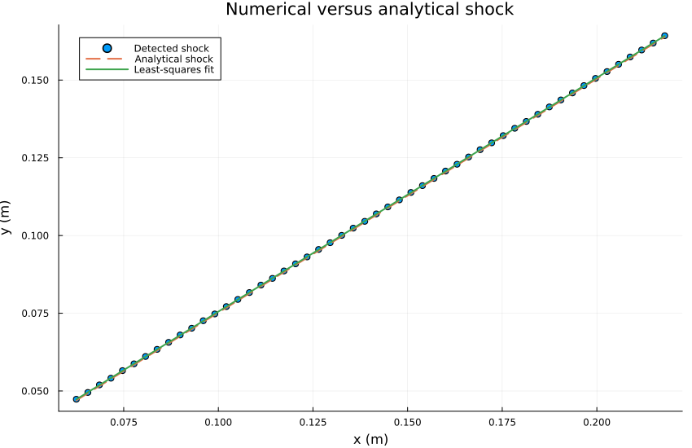

# Mach 2.5 Wedge

## 1. Objective

The objective of this verification case is to evaluate the accuracy
of OpenFOAM's `rhoCentralFoam` solver by comparing its numerical
solution against the analytical oblique-shock relations for
supersonic flow over a 15-degree wedge.

The benchmark is based on NASA Glenn Research Center's
supersonic wedge verification problem.

The freestream Mach number is

$$
M_1=2.5
$$

and the wedge deflection angle is

$$
\theta=15^\circ.
$$

The quantities of interest are:

- Oblique shock angle
- Downstream pressure ratio
- Downstream density ratio
- Downstream temperature ratio
- Downstream Mach number
- Post-shock velocity components
- Shock location and numerical thickness
- Numerical oscillations and dissipation
- Accuracy of the shock-detection algorithm

This is primarily a **verification problem**, rather than
an experimental validation problem, because an analytical
solution exists for the inviscid oblique shock.

The numerical solution is compared against the exact
Rankine–Hugoniot relations and NASA's published reference
values.

---

## 2. Problem Definition

Consider a uniform supersonic flow approaching a sharp
two-dimensional wedge.

The freestream velocity is aligned with the positive
$x$-direction.

The wedge surface deflects the flow upward by an angle
$\theta=15^\circ$.

For the specified Mach number and wedge angle, an attached
oblique shock forms at the wedge leading edge.

Two approximately uniform flow regions are produced:

- **State 1:** Undisturbed supersonic gas upstream of the shock.
- **State 2:** Compressed and deflected gas downstream of the shock.

### 2.1 Freestream Conditions

| Parameter | Symbol | Value | Units |
|---|---|---:|---|
| Freestream Mach number | $M_1$ | 2.5 | - |
| Wedge deflection angle | $\theta$ | 15 | degrees |
| Static pressure | $p_1$ | 101352.9 | Pa |
| Static temperature | $T_1$ | 288.8889 | K |
| Specific heat at constant pressure | $c_p$ | 1004.5 | J/(kg K) |
| Molecular weight | $W$ | 28.970 | kg/kmol |
| Ratio of specific heats | $\gamma$ | approximately 1.4 | - |

The thermodynamic constants are consistent with the
OpenFOAM `thermophysicalProperties` dictionary.

The specific gas constant is

$$
R=\frac{R_u}{W}.
$$

The specific heat at constant volume is

$$
c_v=c_p-R.
$$

Therefore,

$$
\boxed{
\gamma=\frac{c_p}{c_p-R}
}
$$

For numerical verification, the exact value calculated
from the input properties should be used rather than
independently rounding $\gamma$ to 1.4.

### 2.2 Computational Domain

The computational geometry follows the NASA benchmark.

| Parameter | Value |
|---|---:|
| Inlet position | $x=-0.1524$ m |
| Wedge leading edge | $x=0$ m |
| Outlet position | $x=0.3048$ m |
| Upper boundary | $y=0.3048$ m |
| Wedge angle | 15 degrees |
| Spanwise thickness | 0.001 m |

The wedge surface is defined by

$$
\boxed{
y_w(x)=x\tan\theta
}
$$

for $x\geq0$.

The analytical shock location is

$$
\boxed{
y_s(x)=x\tan\beta
}
$$

where $\beta$ is the oblique shock angle.

### 2.3 Numerical Mesh

The domain is discretized using two structured
hexahedral blocks generated by `blockMesh`.

| Block | $N_x$ | $N_y$ | $N_z$ | Cells |
|---|---:|---:|---:|---:|
| Upstream | 50 | 100 | 1 | 5000 |
| Wedge region | 100 | 100 | 1 | 10000 |
| Total | - | - | - | 15000 |

The mesh is one cell thick in the spanwise direction.

The front and back boundaries use the OpenFOAM `empty`
boundary condition, resulting in an effectively
two-dimensional calculation.

### 2.4 Physical Assumptions

1. Two-dimensional compressible flow.
2. Inviscid flow governed by the Euler equations.
3. Calorically perfect gas.
4. Constant thermodynamic properties.
5. No chemical reactions.
6. No modeled turbulence.
7. No physical viscous boundary layer.
8. Impermeable slip condition on the wedge.
9. Uniform freestream conditions.
10. An attached weak oblique shock.

---

## 3. Governing Equations

The governing equations are the compressible Euler
equations in two spatial dimensions.

The conservative state vector is

$$
\mathbf Q=
\begin{bmatrix}
\rho\\
\rho u\\
\rho v\\
\rho E
\end{bmatrix}.
$$

The conservative equations are

$$
\frac{\partial\mathbf Q}{\partial t}
+
\frac{\partial\mathbf F}{\partial x}
+
\frac{\partial\mathbf G}{\partial y}
=0.
$$

The inviscid flux vectors are

$$
\mathbf F=
\begin{bmatrix}
\rho u\\
\rho u^2+p\\
\rho uv\\
u(\rho E+p)
\end{bmatrix}
$$

and

$$
\mathbf G=
\begin{bmatrix}
\rho v\\
\rho uv\\
\rho v^2+p\\
v(\rho E+p)
\end{bmatrix}.
$$

The specific total energy is

$$
E=e+\frac{u^2+v^2}{2}.
$$

For a calorically perfect gas,

$$
e=c_vT
$$

and

$$
p=\rho RT.
$$

The local speed of sound is

$$
a=\sqrt{\gamma RT}.
$$

The Mach number is

$$
\boxed{
M=\frac{\sqrt{u^2+v^2}}{a}
}
$$

These relations close the system of conservation equations.

---

## 4. Analytical Oblique-Shock Solution

### 4.1 Shock Geometry

The velocity can be decomposed into normal and
tangential components relative to the shock.

Upstream,

$$
U_{n1}=U_1\sin\beta
$$

and

$$
U_{t1}=U_1\cos\beta.
$$

The upstream normal Mach number is

$$
\boxed{
M_{n1}=M_1\sin\beta
}
$$

Across an inviscid oblique shock, the tangential
velocity is unchanged:

$$
\boxed{
U_{t2}=U_{t1}
}
$$

Mass conservation gives

$$
\rho_1U_{n1}=\rho_2U_{n2}.
$$

The normal velocity decreases because the density
increases across the compressive shock.

### 4.2 Theta-Beta-Mach Relation

The oblique shock angle satisfies

$$
\boxed{
\tan\theta=
2\cot\beta
\frac{M_1^2\sin^2\beta-1}
{M_1^2(\gamma+\cos2\beta)+2}
}
\tag{1}
$$

For the present problem,

$$
M_1=2.5
$$

and

$$
\theta=15^\circ.
$$

Equation (1) is solved numerically for $\beta$.

The weak attached-shock solution is selected.

NASA's published analytical result is

$$
\boxed{
\beta_{\mathrm{exact}}=36.94490^\circ
}
$$

### 4.3 Pressure Ratio

Using the upstream normal Mach number,

$$
M_{n1}=M_1\sin\beta,
$$

the normal-shock pressure relation gives

$$
\boxed{
\frac{p_2}{p_1}
=
1+\frac{2\gamma}{\gamma+1}
(M_{n1}^2-1)
}
\tag{2}
$$

The NASA reference value is

$$
\boxed{
\frac{p_2}{p_1}=2.467500
}
$$

### 4.4 Density Ratio

The normal-shock density relation gives

$$
\boxed{
\frac{\rho_2}{\rho_1}
=
\frac{(\gamma+1)M_{n1}^2}
{(\gamma-1)M_{n1}^2+2}
}
\tag{3}
$$

The analytical result is

$$
\boxed{
\frac{\rho_2}{\rho_1}=1.866549
}
$$

### 4.5 Temperature Ratio

From the ideal-gas equation,

$$
\frac{p_2}{p_1}
=
\frac{\rho_2}{\rho_1}
\frac{T_2}{T_1}.
$$

Therefore,

$$
\boxed{
\frac{T_2}{T_1}
=
\frac{p_2/p_1}{\rho_2/\rho_1}
}
\tag{4}
$$

The analytical result is

$$
\boxed{
\frac{T_2}{T_1}=1.321958
}
$$

### 4.6 Downstream Mach Number

The downstream normal Mach number satisfies

$$
M_{n2}^2=
\frac{
1+\frac{\gamma-1}{2}M_{n1}^2
}{
\gamma M_{n1}^2-\frac{\gamma-1}{2}
}.
$$

The downstream Mach number is obtained from

$$
\boxed{
M_2=
\frac{M_{n2}}{\sin(\beta-\theta)}
}
\tag{5}
$$

The analytical result is

$$
\boxed{
M_2=1.873526
}
$$

### 4.7 Reference Solution Summary

| Quantity | Analytical Value |
|---|---:|
| Shock angle | 36.94490 degrees |
| Downstream Mach number | 1.873526 |
| Pressure ratio | 2.467500 |
| Density ratio | 1.866549 |
| Temperature ratio | 1.321958 |

These values are the analytical references used
throughout the verification.

---

## 5. Numerical Method

The simulation uses OpenFOAM v2606 with
the `rhoCentralFoam` solver.

The solver uses a density-based central-upwind
formulation for compressible flow.

### 5.1 Finite-Volume Discretization

Integrating the conservation equations over a
computational cell gives

$$
\frac{d}{dt}(\mathbf Q_iV_i)
+
\sum_{f\in\partial V_i}
\widehat{\mathbf F}_f\cdot\mathbf S_f
=0.
$$

Here,

- $V_i$ is the computational cell volume.
- $\mathbf Q_i$ is the cell conservative state.
- $\mathbf S_f$ is the outward face-area vector.
- $\widehat{\mathbf F}_f$ is the numerical face flux.

The numerical flux approximates the transport of
conserved quantities between neighboring cells.

### 5.2 Solver Configuration

| Component | Configuration |
|---|---|
| Solver | `rhoCentralFoam` |
| Convective flux | Kurganov |
| Temporal scheme | Euler |
| Gradient scheme | Gauss linear |
| Density reconstruction | Minmod |
| Velocity reconstruction | MinmodV |
| Temperature reconstruction | Minmod |
| Maximum Courant number | 0.2 |
| Initial time step | $10^{-7}$ s |
| Maximum time step | $10^{-7}$ s |

The Minmod limiter was used to reduce the potential
for nonphysical oscillations near the shock.

This introduces numerical dissipation and produces
a shock transition distributed across several cells.

The resulting numerical shock thickness is not
the physical molecular thickness of the shock.

---

## 6. Verification Methodology

The numerical solution is analyzed independently
using Julia.

The verification program reads the OpenFOAM
cell-centered fields:

- `Cx`
- `Cy`
- `p`
- `T`
- `U`

Density and Mach number are reconstructed
from the extracted primitive variables.

### 6.1 Numerical Density

$$
\boxed{
\rho_h=\frac{p_h}{RT_h}
}
$$

### 6.2 Numerical Mach Number

$$
\boxed{
M_h=
\frac{\sqrt{u_h^2+v_h^2}}
{\sqrt{\gamma RT_h}}
}
$$

### 6.3 Shock Detection

The pressure midpoint is defined as

$$
\boxed{
p_{\mathrm{mid}}=\frac{p_1+p_2}{2}
}
$$

At each streamwise station, two neighboring
cells are identified such that

$$
p_i\geq p_{\mathrm{mid}}
$$

and

$$
p_{i+1}<p_{\mathrm{mid}}.
$$

The numerical shock position is obtained by
linear interpolation:

$$
\boxed{
y_s=
y_i+
\frac{p_{\mathrm{mid}}-p_i}
{p_{i+1}-p_i}
(y_{i+1}-y_i)
}
\tag{6}
$$

This method locates a consistent position
inside the captured pressure transition.

### 6.4 Shock-Angle Estimation

The detected shock positions are fitted to

$$
y_s(x)=mx+b.
$$

The coefficients are calculated by solving

$$
\min_{m,b}
\sum_{i=1}^N
(y_{s,i}-mx_i-b)^2.
$$

The numerical shock angle is

$$
\boxed{
\beta_h=\tan^{-1}(m)
}
\tag{7}
$$

The shock-angle error is

$$
\boxed{
E_\beta=
|\beta_h-\beta_{\mathrm{exact}}|
}
\tag{8}
$$

The fitted intercept $b$ provides an additional
measure of geometric agreement.

For the ideal attached shock originating at
$(0,0)$, the analytical intercept is zero.

---

## 7. Numerical Results

### 7.1 Numerical Pressure Field

**Figure 1.** Normalized pressure field, with the analytical shock and
numerically detected shock positions.

The numerical solution exhibits the expected attached oblique-shock structure. The shock originates near the wedge leading edge and extends upward through the computational domain.

The pressure field shows good agreement with the analytical solution.

### 7.2 Vertical Pressure Profiles

**Figure 2.** Normalized pressure profiles at
four streamwise sampling locations.

The sampling positions are approximately

$$
x=
0.081,\ 0.120,\ 0.160,\ 0.200
\quad\mathrm m.
$$

The analytical upstream pressure ratio is

$$
\frac{p_1}{p_1}=1.
$$

The analytical downstream pressure ratio is

$$
\frac{p_2}{p_1}=2.467500.
$$

### 7.3 Shock-Location Error

**Figure 3.** Shock-location residuals relative
to the analytical shock position.

The shock-location error is defined as

$$
\boxed{
e_y(x)=
y_{s,h}(x)-x\tan\beta_{\mathrm{exact}}
}
\tag{9}
$$

### 7.4 Shock Geometry

**Figure 4.** Detected shock positions compared
with the analytical shock line and fitted
numerical shock line.

The numerical detections follow the expected
approximately linear shock geometry.

The analytical shock satisfies

$$
y_s=x\tan36.94490^\circ.
$$

The fitted numerical shock satisfies

$$
y_{s,h}=m_hx+b_h.
$$

The numerical angle is calculated using

$$
\beta_h=\tan^{-1}(m_h).
$$

---

## 8. Verification Results Summary

The analytical reference values are compared
with the quantities calculated from the
OpenFOAM solution.

The relative error for a nonzero reference value is

$$
\boxed{
\epsilon_q=
\frac{|q_h-q_{\mathrm{exact}}|}
{|q_{\mathrm{exact}}|}
\times100\%
}
\tag{10}
$$

For the shock angle, an additional absolute
error in degrees is reported:

$$
\boxed{
E_\beta=
|\beta_h-\beta_{\mathrm{exact}}|
}.
$$

---

## 13. Conclusions

The OpenFOAM solution reproduces the expected
attached oblique-shock structure for Mach 2.5
flow over a 15-degree wedge.

The primary findings are:

1. An attached oblique shock forms near the
   wedge leading edge.

2. The numerical shock follows the predicted
   analytical shock line.

3. The downstream pressure plateau closely
   matches the theoretical pressure ratio
   of 2.467500.

---

## 14. References

1. NASA Glenn Research Center,
   "Supersonic Wedge Verification Case,"
   NPARC Alliance Verification and Validation Archive.
   https://www.grc.nasa.gov/www/wind/valid/wedge/wedge.html

2. OpenCFD Ltd.,
   *OpenFOAM v2606 Documentation*.
   https://doc.openfoam.com/2606/

3. Anderson, J. D.,
   *Modern Compressible Flow: With Historical Perspective*,
   3rd edition, McGraw-Hill, 2003.

4. Toro, E. F.,
   *Riemann Solvers and Numerical Methods for Fluid Dynamics*,
   3rd edition, Springer, 2009.

5. LeVeque, R. J.,
   *Finite Volume Methods for Hyperbolic Problems*,
   Cambridge University Press, 2002.

6. Kurganov, A., and Tadmor, E.,
   "New High-Resolution Central Schemes for Nonlinear
   Conservation Laws and Convection–Diffusion Equations,"
   *Journal of Computational Physics*,
   Vol. 160, No. 1, pp. 241–282, 2000.
