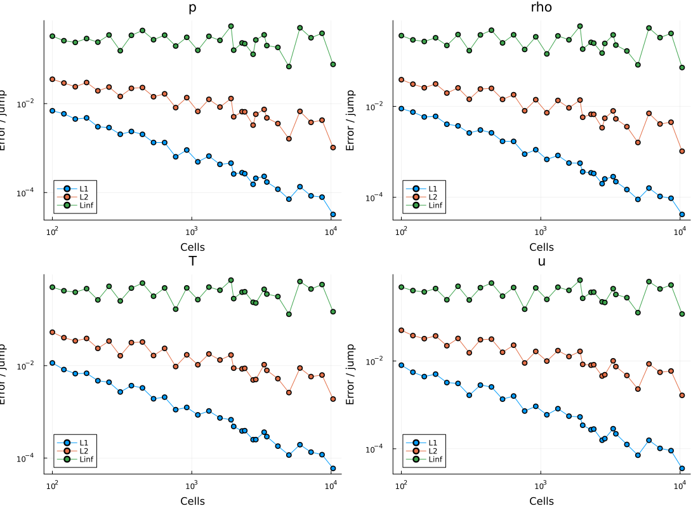
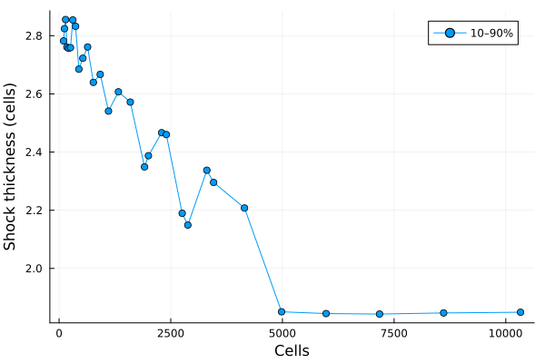
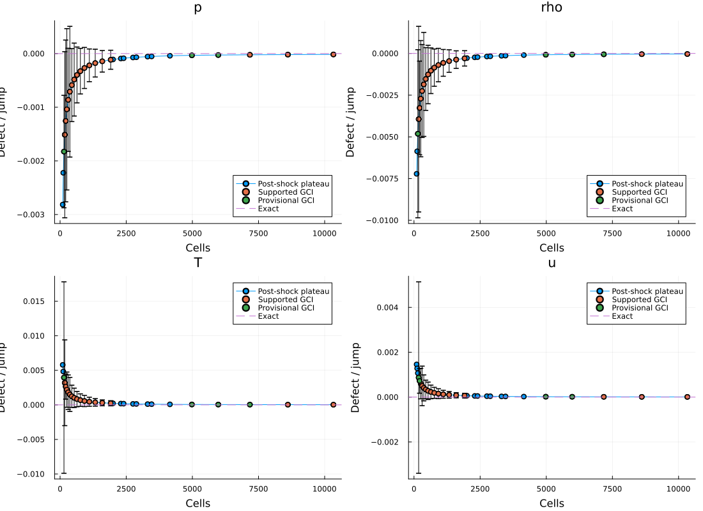
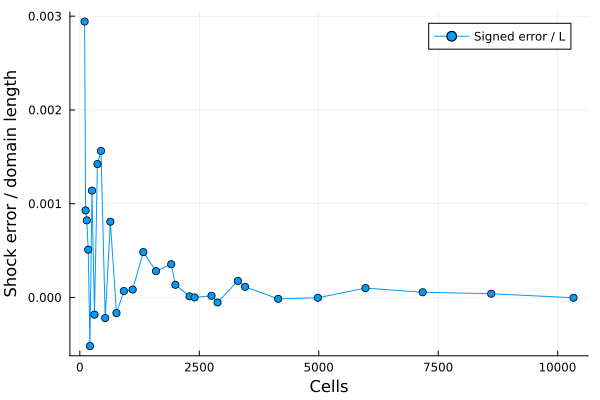
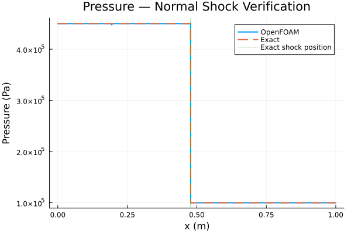
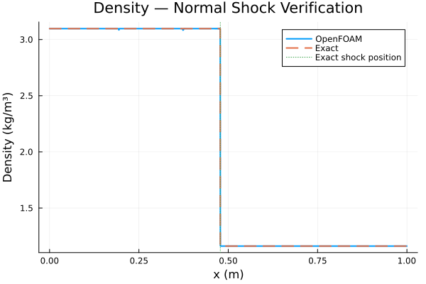
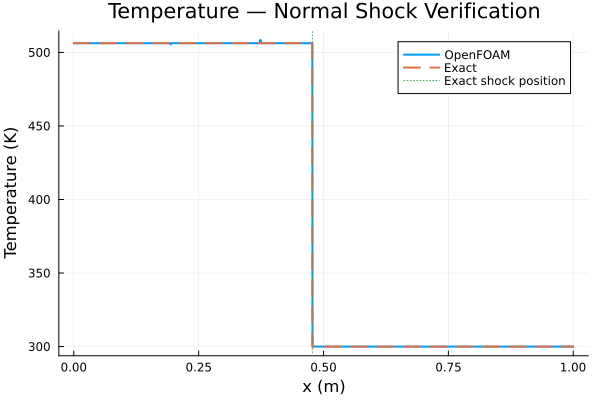
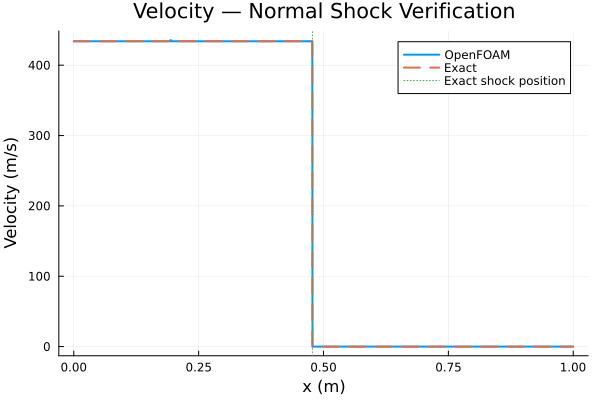

# Analytical Verification of a Moving Normal Shock

## 1. Objective

The objective of this verification case is to assess the accuracy of
OpenFOAM's `rhoCentralFoam` solver by comparing its numerical solution
against the exact Rankine–Hugoniot solution for a one-dimensional
normal shock.

The shock propagates through an initially stationary, calorically
perfect gas.

The quantities of interest are:

- Shock propagation speed
- Shock position as a function of time
- Pressure jump
- Density jump
- Temperature jump
- Post-shock velocity
- Conservation of mass, momentum, and total energy

This is a **verification problem**, rather than an experimental validation
problem, because an analytical solution is available.

## 2. Problem Definition

Consider a planar normal shock propagating in the positive
$x$-direction.

Two uniform thermodynamic states exist:

- **State 1:** Undisturbed gas ahead of the shock.
- **State 2:** Compressed gas behind the shock.

The initial shock location is $x_0=0.2$ m.

### 2.1 Initial Conditions

| Parameter | Symbol | Value | Units |
|---|---|---:|---|
| Upstream pressure | $p_1$ | 100000 | Pa |
| Upstream temperature | $T_1$ | 300 | K |
| Upstream velocity | $u_1$ | 0 | m/s |
| Shock Mach number | $M_s$ | 2 | - |
| Specific heat at constant pressure | $c_p$ | 1004.5 | J/(kg K) |
| Molecular weight | $W$ | 28.970 | kg/kmol |
| Initial shock position | $x_0$ | 0.2 | m |
| Domain length | $L$ | 1.0 | m |
| Final simulation time | $t_f$ | 0.0004 | s |

### 2.2 Assumptions

1. One-dimensional compressible flow.
2. Inviscid flow governed by the Euler equations.
3. Calorically perfect gas.
4. Constant specific heats.
5. No chemical reactions.
6. No body forces or volumetric heat sources.
7. Uniform thermodynamic states on either side of the shock.
8. The shock propagates at constant speed.
9. Boundary interactions do not influence the shock over the analysis interval.

The shock is treated as a mathematical discontinuity. Its physical
internal structure is not resolved.

---

## 3. Governing Equations

The one-dimensional Euler equations can be written in conservative form:

$$
\frac{\partial \mathbf Q}{\partial t}
+
\frac{\partial \mathbf F(\mathbf Q)}{\partial x}
=0
$$

where the conservative state vector is

$$
\mathbf Q=
\begin{bmatrix}
\rho\\
\rho u\\
\rho E
\end{bmatrix}
$$

and the inviscid flux vector is

$$
\mathbf F(\mathbf Q)=
\begin{bmatrix}
\rho u\\
\rho u^2+p\\
u(\rho E+p)
\end{bmatrix}.
$$

The specific total energy is

$$
E=e+\frac{u^2}{2}.
$$

For a calorically perfect gas,

$$
e=c_vT
$$

and

$$
p=\rho RT.
$$

The specific heats satisfy

$$
c_p-c_v=R
$$

and

$$
\gamma=\frac{c_p}{c_v}.
$$

Consequently,

$$
c_v=c_p-R
$$

and

$$
\boxed{
\gamma=\frac{c_p}{c_p-R}
}
$$

These thermodynamic relations close the Euler equations.

---

## 4. Shock-Fixed Reference Frame

The Rankine–Hugoniot conditions are conveniently derived in a
reference frame moving with the shock.

Let $V_s$ denote the shock propagation velocity.

The shock-relative velocity is

$$
w=u-V_s.
$$

Because the shock travels faster than the gas in this problem,
$w$ is negative.

Define a positive relative flow speed:

$$
v=V_s-u.
$$

Therefore,

$$
v_1=V_s-u_1
$$

and

$$
v_2=V_s-u_2.
$$

Since the upstream gas is stationary,

$$
u_1=0,
$$

so

$$
\boxed{v_1=V_s}.
$$

The shock Mach number is

$$
M_s=\frac{V_s}{a_1},
$$

where $a_1$ is the upstream speed of sound.

Hence,

$$
\boxed{M_1=M_s}
$$

for this particular problem, where $M_1=v_1/a_1$.

This equality does not generally hold for a shock propagating
through an upstream gas with nonzero laboratory-frame velocity.

---

## 5. Rankine–Hugoniot Jump Conditions

Consider a conservation law

$$
\frac{\partial Q}{\partial t}
+
\frac{\partial F}{\partial x}=0.
$$

For a discontinuity moving at speed $V_s$, integration across
the moving interface gives

$$
V_s[Q]=[F],
$$

where

$$
[Q]=Q_2-Q_1
$$

denotes the jump between the two states.

Applying this relation to the Euler equations produces three
independent conservation conditions.

### 5.1 Conservation of Mass

In the shock-fixed reference frame,

$$
\rho_1v_1=\rho_2v_2.
$$

Define the mass flux

$$
m=\rho_1v_1=\rho_2v_2.
$$

Therefore,

$$
\boxed{
\frac{v_2}{v_1}=\frac{\rho_1}{\rho_2}
}
$$

An increase in density must correspond to a decrease in the
velocity relative to the shock.

### 5.2 Conservation of Momentum

The momentum jump condition is

$$
p_1+\rho_1v_1^2
=
p_2+\rho_2v_2^2.
$$

Using the constant mass flux,

$$
p_1+mv_1=p_2+mv_2.
$$

Rearranging,

$$
\boxed{
p_2-p_1=m(v_1-v_2)
}
$$

Substituting the mass-conservation relation gives

$$
\boxed{
p_2-p_1
=
\rho_1v_1^2
\left(
1-\frac{\rho_1}{\rho_2}
\right)
}
$$

### 5.3 Conservation of Energy

The energy jump condition in the shock-fixed frame is

$$
h_1+\frac{v_1^2}{2}
=
h_2+\frac{v_2^2}{2}.
$$

For a calorically perfect gas,

$$
h=c_pT.
$$

Therefore,

$$
c_pT_1+\frac{v_1^2}{2}
=
c_pT_2+\frac{v_2^2}{2}.
$$

Rearranging,

$$
\boxed{
c_p(T_2-T_1)
=
\frac{v_1^2-v_2^2}{2}
}
$$

The decrease in shock-relative kinetic energy corresponds
to an increase in gas enthalpy.

---

## 6. Derivation of the Density Ratio

Define the compression ratio

$$
r=\frac{\rho_2}{\rho_1}.
$$

Mass conservation gives

$$
v_2=\frac{v_1}{r}.
$$

Substitute this expression into momentum conservation:

$$
p_2-p_1
=
\rho_1v_1^2
\left(1-\frac{1}{r}\right).
$$

Using the ideal-gas equation,

$$
p_1=\rho_1RT_1
$$

and

$$
p_2=r\rho_1RT_2.
$$

Therefore,

$$
rRT_2-RT_1
=
v_1^2\left(1-\frac{1}{r}\right).
$$

Divide by $RT_1$:

$$
r\frac{T_2}{T_1}-1
=
\frac{v_1^2}{RT_1}
\left(1-\frac{1}{r}\right).
$$

The upstream speed of sound is

$$
a_1^2=\gamma RT_1.
$$

Since

$$
M_1=\frac{v_1}{a_1},
$$

we obtain

$$
\frac{v_1^2}{RT_1}=\gamma M_1^2.
$$

Thus,

$$
\boxed{
r\frac{T_2}{T_1}-1
=
\gamma M_1^2
\left(1-\frac{1}{r}\right)
}
\tag{1}
$$

Now consider the energy equation:

$$
c_p(T_2-T_1)
=
\frac{v_1^2}{2}
\left(1-\frac{1}{r^2}\right).
$$

Using

$$
c_p=\frac{\gamma R}{\gamma-1}
$$

and

$$
v_1^2=\gamma RT_1M_1^2,
$$

we obtain

$$
\frac{\gamma R}{\gamma-1}(T_2-T_1)
=
\frac{\gamma RT_1M_1^2}{2}
\left(1-\frac{1}{r^2}\right).
$$

Divide by $\gamma RT_1$:

$$
\frac{1}{\gamma-1}
\left(\frac{T_2}{T_1}-1\right)
=
\frac{M_1^2}{2}
\left(1-\frac{1}{r^2}\right).
$$

Therefore,

$$
\boxed{
\frac{T_2}{T_1}
=
1+\frac{\gamma-1}{2}M_1^2
\left(1-\frac{1}{r^2}\right)
}
\tag{2}
$$

Substitute Equation (2) into Equation (1):

$$
r\left[
1+\frac{\gamma-1}{2}M_1^2
\left(1-\frac{1}{r^2}\right)
\right]-1
=
\gamma M_1^2
\left(1-\frac{1}{r}\right).
$$

Expand:

$$
r-1+
\frac{\gamma-1}{2}M_1^2
\left(r-\frac{1}{r}\right)
=
\gamma M_1^2
\left(1-\frac{1}{r}\right).
$$

Multiply through by $r$:

$$
r(r-1)
+
\frac{\gamma-1}{2}M_1^2(r^2-1)
=
\gamma M_1^2(r-1).
$$

Factor $(r-1)$:

$$
(r-1)
\left[
r+
\frac{\gamma-1}{2}M_1^2(r+1)
-\gamma M_1^2
\right]=0.
$$

The solution $r=1$ corresponds to no discontinuity.

For a nontrivial shock, the bracketed expression must vanish:

$$
r+
\frac{\gamma-1}{2}M_1^2(r+1)
-\gamma M_1^2=0.
$$

Collect terms:

$$
r\left[2+(\gamma-1)M_1^2\right]
=
(\gamma+1)M_1^2.
$$

Therefore,

$$
\boxed{
\frac{\rho_2}{\rho_1}
=
\frac{(\gamma+1)M_1^2}
{(\gamma-1)M_1^2+2}
}
\tag{3}
$$

This is the exact normal-shock density ratio for a
calorically perfect gas.

---

## 7. Derivation of the Pressure Ratio

Start with the momentum jump condition:

$$
p_2-p_1
=
\rho_1v_1^2
\left(1-\frac{1}{r}\right).
$$

Divide by $p_1$:

$$
\frac{p_2}{p_1}-1
=
\frac{\rho_1v_1^2}{p_1}
\left(1-\frac{1}{r}\right).
$$

Using

$$
p_1=\rho_1RT_1
$$

and

$$
v_1^2=\gamma RT_1M_1^2,
$$

we obtain

$$
\frac{p_2}{p_1}-1
=
\gamma M_1^2
\left(1-\frac{1}{r}\right).
$$

From Equation (3),

$$
\frac{1}{r}
=
\frac{(\gamma-1)M_1^2+2}
{(\gamma+1)M_1^2}.
$$

Therefore,

$$
1-\frac{1}{r}
=
\frac{2(M_1^2-1)}
{(\gamma+1)M_1^2}.
$$

Substitution gives

$$
\frac{p_2}{p_1}-1
=
\frac{2\gamma}{\gamma+1}(M_1^2-1).
$$

Thus,

$$
\boxed{
\frac{p_2}{p_1}
=
1+\frac{2\gamma}{\gamma+1}(M_1^2-1)
}
\tag{4}
$$

An equivalent expression is

$$
\boxed{
\frac{p_2}{p_1}
=
\frac{2\gamma M_1^2-(\gamma-1)}
{\gamma+1}
}
$$

---

## 8. Derivation of the Temperature Ratio

From the ideal-gas equation,

$$
p=\rho RT.
$$

Taking the ratio between states,

$$
\frac{p_2}{p_1}
=
\frac{\rho_2}{\rho_1}
\frac{T_2}{T_1}.
$$

Therefore,

$$
\boxed{
\frac{T_2}{T_1}
=
\frac{p_2/p_1}{\rho_2/\rho_1}
}
$$

Substituting Equations (3) and (4),

$$
\boxed{
\frac{T_2}{T_1}
=
\frac{
[2\gamma M_1^2-(\gamma-1)]
[(\gamma-1)M_1^2+2]
}{
(\gamma+1)^2M_1^2
}
}
\tag{5}
$$

The shock is adiabatic but irreversible.

Consequently, entropy increases across a physical compressive shock,
even though no external heat is added.

---

## 9. Derivation of the Laboratory-Frame Velocity

The Rankine–Hugoniot relations determine velocities relative
to the moving shock.

To recover the laboratory-frame velocity, begin with
mass conservation:

$$
\rho_1(V_s-u_1)
=
\rho_2(V_s-u_2).
$$

Since the upstream gas is stationary,

$$
u_1=0.
$$

Therefore,

$$
\rho_1V_s
=
\rho_2(V_s-u_2).
$$

Divide by $\rho_2$:

$$
\frac{\rho_1}{\rho_2}V_s
=
V_s-u_2.
$$

Rearranging,

$$
\boxed{
u_2=
V_s\left(1-\frac{\rho_1}{\rho_2}\right)
}
\tag{6}
$$

Using the compression ratio,

$$
\boxed{
u_2=V_s\left(1-\frac{1}{r}\right)
}
$$

For a compressive shock, $r>1$, so

$$
0<u_2<V_s.
$$

The gas is accelerated in the laboratory frame, but its velocity
relative to the shock decreases.

This result follows directly from conservation of mass.

---

## 10. Shock Speed

The specific gas constant is determined from the universal
gas constant and molecular weight:

$$
\boxed{
R=\frac{R_u}{W}
}
$$

Using

$$
R_u=8314.462618\ \mathrm{J/(kmol\,K)}
$$

and

$$
W=28.970\ \mathrm{kg/kmol},
$$

we obtain

$$
R\approx287.00\ \mathrm{J/(kg\,K)}.
$$

The specific heat ratio must be calculated consistently:

$$
\boxed{
\gamma=\frac{c_p}{c_p-R}
}
$$

The upstream speed of sound is

$$
a_1=\sqrt{\gamma RT_1}.
$$

By definition, the shock Mach number is

$$
M_s=\frac{V_s}{a_1}.
$$

Therefore,

$$
\boxed{
V_s=M_s\sqrt{\gamma RT_1}
}
\tag{7}
$$

For $M_s=2$,

$$
\boxed{
V_s\approx694.4\ \mathrm{m/s}
}
$$

---

## 11. Numerical Evaluation

For readability, the following values use
$\gamma\approx1.4$ and $R\approx287\ \mathrm{J/(kg\,K)}$.

Strict numerical verification should instead use the exact
thermodynamic constants specified in OpenFOAM.

### 11.1 Pressure

From Equation (4),

$$
\frac{p_2}{p_1}
=
1+\frac{2(1.4)}{1.4+1}(2^2-1).
$$

Therefore,

$$
\frac{p_2}{p_1}=4.5.
$$

Hence,

$$
\boxed{
p_2=450000\ \mathrm{Pa}
}
$$

### 11.2 Density

The upstream density is

$$
\rho_1=\frac{p_1}{RT_1}.
$$

Therefore,

$$
\rho_1=\frac{100000}{287(300)}.
$$

Thus,

$$
\boxed{
\rho_1\approx1.1614\ \mathrm{kg/m^3}
}
$$

The density ratio is

$$
\frac{\rho_2}{\rho_1}
=
\frac{(1.4+1)(2^2)}
{(1.4-1)(2^2)+2}.
$$

Therefore,

$$
\frac{\rho_2}{\rho_1}=\frac83.
$$

Hence,

$$
\boxed{
\rho_2\approx3.097\ \mathrm{kg/m^3}
}
$$

### 11.3 Temperature

From Equation (5),

$$
\frac{T_2}{T_1}
=
\frac{4.5}{8/3}.
$$

Therefore,

$$
\frac{T_2}{T_1}=1.6875.
$$

Hence,

$$
\boxed{
T_2=506.25\ \mathrm K
}
$$

### 11.4 Velocity

From Equation (6),

$$
u_2=V_s\left(1-\frac38\right).
$$

Therefore,

$$
u_2=\frac58V_s.
$$

Hence,

$$
\boxed{
u_2\approx434.0\ \mathrm{m/s}
}
$$

### 11.5 Summary

| Quantity | State 1 | State 2 | Units |
|---|---:|---:|---|
| Pressure | 100000 | 450000 | Pa |
| Temperature | 300 | 506.25 | K |
| Density | 1.1614 | 3.097 | kg/m³ |
| Laboratory velocity | 0 | 434.0 | m/s |

---

## 12. Shock Trajectory

Because both states are uniform and satisfy the exact
Rankine–Hugoniot conditions, the shock travels at constant speed
before encountering any boundary-generated disturbances.

The shock trajectory satisfies

$$
\frac{dx_s}{dt}=V_s.
$$

Integrating from the initial shock position $x_0$ gives

$$
\int_{x_0}^{x_s(t)}dx
=
\int_0^tV_s\,dt.
$$

Therefore,

$$
\boxed{
x_s(t)=x_0+V_st
}
\tag{8}
$$

At

$$
t_f=4\times10^{-4}\ \mathrm s,
$$

the shock position is approximately

$$
x_s(t_f)=0.2+694.4(0.0004).
$$

Hence,

$$
\boxed{
x_s(t_f)\approx0.4778\ \mathrm m
}
$$

This is the analytical shock position used to verify
the OpenFOAM solution.

---

## 13. Complete Exact Solution

The analytical solution consists of two constant states
separated by a moving discontinuity.

Define the conservative state vectors:

$$
\mathbf Q_1=
\begin{bmatrix}
\rho_1\\
\rho_1u_1\\
\rho_1E_1
\end{bmatrix}
$$

and

$$
\mathbf Q_2=
\begin{bmatrix}
\rho_2\\
\rho_2u_2\\
\rho_2E_2
\end{bmatrix}.
$$

The specific total energy in either state is

$$
E_i=c_vT_i+\frac{u_i^2}{2}.
$$

The shock trajectory is

$$
x_s(t)=x_0+V_st.
$$

The complete solution is

$$
\boxed{
\mathbf Q(x,t)=
\begin{cases}
\mathbf Q_2, & x<x_s(t),\\[6pt]
\mathbf Q_1, & x>x_s(t).
\end{cases}
}
\tag{9}
$$

Equivalently, for any primitive field
$q\in\{\rho,u,p,T\}$,

$$
\boxed{
q(x,t)=
\begin{cases}
q_2, & x<x_0+V_st,\\[6pt]
q_1, & x>x_0+V_st.
\end{cases}
}
$$

The value exactly at the discontinuity is not uniquely
defined by the weak solution.

For numerical verification, comparisons are performed
using cell-centered values or appropriately integrated
cell averages.

**Important:** A conservative finite-volume solver evolves
cell averages, not point samples of the exact solution.
For strict error calculations, the analytical discontinuity
should be integrated over cells intersected by the shock,
rather than simply sampled at their centers.

---

## 14. Verification of the Entropy Condition

Conservation alone is insufficient to distinguish a
physical compressive shock from a nonphysical expansion shock.

The physically admissible solution must satisfy the
entropy inequality.

For a calorically perfect gas, the specific entropy change is

$$
s_2-s_1
=
c_v\ln\left(\frac{T_2}{T_1}\right)
+
R\ln\left(\frac{\rho_1}{\rho_2}\right).
$$

An equivalent expression is

$$
\boxed{
s_2-s_1
=
c_p\ln\left(\frac{T_2}{T_1}\right)
-
R\ln\left(\frac{p_2}{p_1}\right)
}
\tag{10}
$$

For the present shock,

$$
\frac{T_2}{T_1}=1.6875
$$

and

$$
\frac{p_2}{p_1}=4.5.
$$

Thus,

$$
s_2-s_1
=
c_p\ln(1.6875)-R\ln(4.5).
$$

The result is positive:

$$
\boxed{
s_2-s_1>0
}
$$

This confirms that the compressive shock is
thermodynamically admissible.

Although the shock is adiabatic, entropy is generated
because the process is irreversible.

---

## 15. Verification Metrics

Once the OpenFOAM solution is available, it can be
compared with the analytical solution.

### 15.1 Shock Position Error

Let $x_{s,h}$ denote the numerically estimated shock position.

The absolute error is

$$
\boxed{
E_x=
|x_{s,h}-x_s(t)|
}
$$

A nondimensional form is

$$
\boxed{
\epsilon_x=
\frac{|x_{s,h}-x_s(t)|}{L}
}
$$

### 15.2 Field Error

For a numerical field $q_h(x,t)$ and exact field $q(x,t)$,
define

$$
e(x,t)=q_h(x,t)-q(x,t).
$$

The domain-normalized $L_1$ error is

$$
\boxed{
L_1=
\frac{1}{L}
\int_0^L|e(x,t)|\,dx
}
$$

The domain-normalized $L_2$ error is

$$
\boxed{
L_2=
\sqrt{
\frac{1}{L}
\int_0^Le(x,t)^2\,dx
}
}
$$

The maximum error is

$$
\boxed{
L_\infty=
\max_{x\in[0,L]}|e(x,t)|
}
$$

For uniform finite-volume cells, the corresponding
approximations are

$$
L_1\approx
\frac{1}{L}\sum_i|e_i|\Delta x
$$

and

$$
L_2\approx
\sqrt{
\frac{1}{L}\sum_ie_i^2\Delta x
}.
$$

Because the exact solution contains a discontinuity,
global error norms may converge more slowly than the
nominal smooth-region order of the numerical method.

### 15.3 Shock Thickness

A numerical shock is distributed across a finite
number of computational cells.

One reproducible measure is the distance between
the 90% and 10% pressure-jump levels:

$$
p_{90}=p_1+0.9(p_2-p_1)
$$

and

$$
p_{10}=p_1+0.1(p_2-p_1).
$$

The numerical shock thickness is

$$
\boxed{
\delta_s=|x_{10}-x_{90}|
}
$$

where $x_{10}$ and $x_{90}$ are interpolated
crossing locations.

Expressed in cell widths,

$$
\boxed{
N_s=\frac{\delta_s}{\Delta x}
}
$$

This metric characterizes numerical shock smearing,
not the physical molecular thickness of the shock.

---

## 16. Verification Criteria

The OpenFOAM solution should demonstrate:

1. Correct shock propagation direction.
2. Shock position approaching the analytical trajectory.
3. Correct pressure jump away from the numerical transition.
4. Correct density jump.
5. Correct temperature jump.
6. Correct post-shock laboratory-frame velocity.
7. No significant nonphysical oscillations around the discontinuity.
8. Decreasing global error under appropriate mesh refinement.
9. Consistency with integral conservation balances.
10. Positive entropy production across the compressive shock.

Shock-position agreement alone is not sufficient to
establish correct numerical behavior.

The numerical solution must also reproduce the
conservative jump conditions and the physically
admissible entropy solution.

---

## 17. Results

### 17.1 Grid refinement study

The grid refinement study indicates that 7,174 cells, $ \Delta x \approx 0.1394$ mm, as an accuracy-only candidate under the default tolerances.

### 17.2 Selected Results: 7,174 Cells

Here are the results of the OpenFOAM case against the analytic solution:

---

## 18. References

1. Anderson, J. D., *Modern Compressible Flow: With Historical
   Perspective*, 3rd ed., McGraw-Hill, 2003.

2. Toro, E. F., *Riemann Solvers and Numerical Methods for Fluid
   Dynamics: A Practical Introduction*, 3rd ed., Springer, 2009.

3. LeVeque, R. J., *Finite Volume Methods for Hyperbolic Problems*,
   Cambridge University Press, 2002.

4. Rankine, W. J. M., "On the Thermodynamic Theory of Waves of
   Finite Longitudinal Disturbance," *Philosophical Transactions
   of the Royal Society of London*, 1870.

5. Hugoniot, H., "Sur la propagation du mouvement dans les corps
   et spécialement dans les gaz parfaits," *Journal de l'École
   Polytechnique*, 1887–1889.
